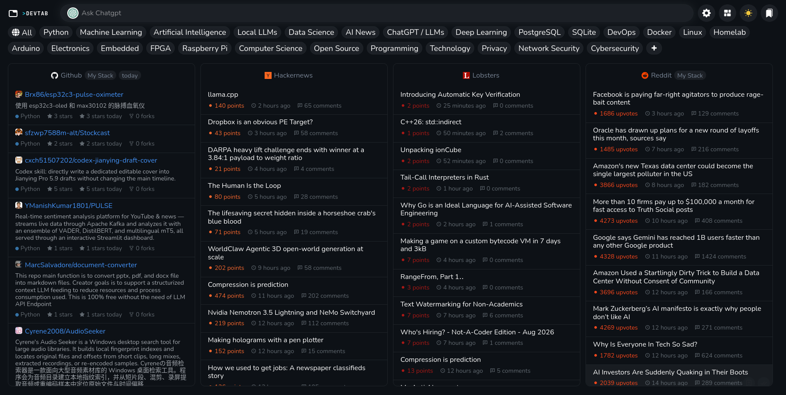

# DevTab

A private, focused developer news page for your browser's new tab. No tracking, no ads, no external backend.

<p align="center">
  
</p>

## Features

- News from GitHub, Hacker News, Lobsters, Product Hunt, Reddit, and your own RSS feeds
- Tag filters and card controls to organize feeds your way
- Bookmarks, read state, and preferences saved locally across sessions
- Do Not Disturb hours, dark/light theme, compact mode
- All requests go directly to each source's public API
- Open source under Apache 2.0

## Install in your Browser

[](https://addons.mozilla.org/en-US/firefox/addon/mdevtab/)


The Chrome Web Store listing is coming soon. To try Chrome now, build and load the
extension locally using the instructions below.

## Build from source

Requires Node >= 22, npm, and `zip` for packaging. See `make help` for all tasks.

```bash
make install
make test
make package
```

`make package` builds both browsers and creates `firefox_extension.zip` and
`chrome_extension.zip` in the project root. Upload each ZIP manually to its store.
Neither local commands nor CI submit or publish anything.

| Task | Make | npm | Output |
| --- | --- | --- | --- |
| Build both | `make build` | `npm run build:all` | `dist/firefox/`, `dist/chrome/` |
| Build Firefox | `make build-firefox` | `npm run build:firefox` | `dist/firefox/` |
| Build Chrome | `make build-chrome` | `npm run build:chrome` | `dist/chrome/` |
| Package both | `make package` | `npm run package:all` | Both extension ZIPs |
| Package Firefox | `make package-firefox` | `npm run package:firefox` | `firefox_extension.zip` |
| Package Chrome | `make package-chrome` | `npm run package:chrome` | `chrome_extension.zip` |

Each browser has its own output directory, so rebuilding one preserves the other.
The version in `package.json` is injected into both manifests. Firefox retains its
Gecko settings and background script; Chrome uses a service worker and omits Gecko
settings. Preferences use `localStorage`, which does not require the extension
`storage` permission. Custom RSS permissions are requested for each feed's origin.

`npm run build:ext` remains a Firefox build alias. `npm run build:firefox` now only
builds; use `npm run package:firefox` to also create its ZIP. The legacy
`bash script/build-firefox.sh` still builds and packages Firefox.

## Test locally

- **Chrome:** open `chrome://extensions`, enable Developer mode, click **Load
  unpacked**, and select `dist/chrome/`. Open a new tab to use DevTab.
- **Firefox:** open `about:debugging#/runtime/this-firefox`, click **Load Temporary
  Add-on**, and select `dist/firefox/manifest.json`. Open a new tab and grant feed
  permissions if prompted. This temporary installation ends when Firefox closes.

After rebuilding, reload the extension in the browser's extension management page
and reopen the new tab page. A Vite web preview does not test extension permissions
or background messaging.

## Manual releases

For a later release, choose a version greater than the one in **both** stores:

```bash
VERSION=1.3.2 make release
```

This updates the shared version, installs dependencies, runs checks, builds both
packages, and creates `source_code.zip` for Firefox source review. Test both
extensions locally, then upload the browser-specific ZIP to the existing listing
in each store. `make source` creates the Firefox source archive independently.
CI checks and packages both browsers on pushes and pull requests; it does not
publish. Release ZIPs are generated locally and ignored by Git.

## Development

```bash
make dev
```

## License

Apache 2.0. See [LICENSE](/LICENSE).
