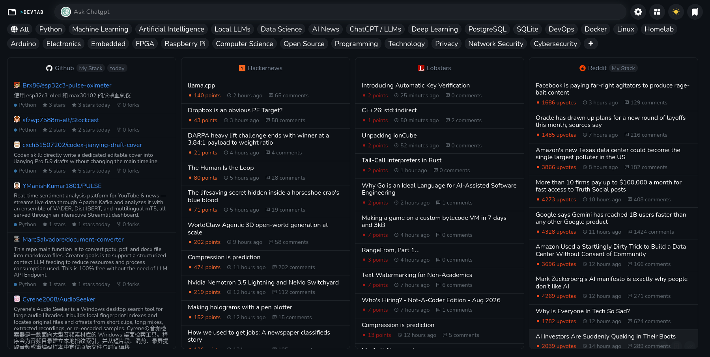

# DevTab

A private, focused developer news page for your browser's new tab. No tracking, no ads, no external backend.

<p align="center">
  
</p>

## Features

- News from GitHub, Hacker News, Lobsters, Product Hunt, and your own RSS feeds
- The Reddit card builds a combined feed from your followed topics via [Redlisten](#follow-reddit).
- Tag filters and card controls to organize feeds your way
- Bookmarks, read state, and preferences saved locally across sessions
- Do Not Disturb hours, dark/light theme, compact mode
- All requests go directly to each source's public API
- Open source under Apache 2.0

## Install in your Browser

[](https://addons.mozilla.org/en-US/firefox/addon/mdevtab/)
[](https://chromewebstore.google.com/detail/devtab/bohcncbmpdonbeamifbibleeghmbdece)

To test a local build, follow the [local installation instructions](#test-locally).

## Follow Reddit

1. Create a free Redlisten account and copy your API key from the dashboard. [Redlisten dashboard](https://app.redlisten.com/)
2. In onboarding, or under **Settings → Sources → Reddit via Redlisten**, paste the key and select **Save key**. DevTab stores the key in the current browser profile and sends it to Redlisten when fetching posts. You can replace or remove it in Sources.
3. **My Stack** automatically combines the subreddits for your followed topics. Use the card's **Topic** menu to view one topic or switch to **Tech**, which combines `r/programming`, `r/technology`, and `r/compsci`. The Tech feed also covers an empty stack.

DevTab asks for up to 25 recent posts in one request across the selected subreddits. Under **Settings → Sources → Reddit via Redlisten**, you can choose 10, 25, or 50 posts per feed. Redlisten may have fewer recent posts available.

DevTab refreshes each combination of subreddits and post limit at most once every 24 hours. It makes up to 20 Reddit feed requests per UTC day per browser profile, including setup checks, and reuses the cache across tabs and restarts. Redlisten’s free account has a shared monthly limit of 1,000 requests and 50,000 results. [Redlisten plan limits](https://www.redlisten.com/docs#plans)

The key setup and Reddit card show when Redlisten rejects a key, denies feed access, reaches a quota, or has a service error. DevTab keeps cached posts available and waits for Redlisten's retry window before making another request with the same key. [Redlisten API errors](https://www.redlisten.com/docs#errors)

## Build from source

Requires Node >= 22, npm, and `zip` for packaging. See `make help` for all tasks.

```bash
make install
make test
make package
```

`make package` builds both browsers and creates `firefox_extension.zip` and
`chrome_extension.zip` in the project root. Upload each ZIP manually to its store.
Neither local commands nor CI submit or publish anything.

| Task | Make | npm | Output |
| --- | --- | --- | --- |
| Build both | `make build` | `npm run build:all` | `dist/firefox/`, `dist/chrome/` |
| Build Firefox | `make build-firefox` | `npm run build:firefox` | `dist/firefox/` |
| Build Chrome | `make build-chrome` | `npm run build:chrome` | `dist/chrome/` |
| Package both | `make package` | `npm run package:all` | Both extension ZIPs |
| Package Firefox | `make package-firefox` | `npm run package:firefox` | `firefox_extension.zip` |
| Package Chrome | `make package-chrome` | `npm run package:chrome` | `chrome_extension.zip` |

Each browser has its own output directory, so rebuilding one preserves the other.
The version in `package.json` is injected into both manifests. Firefox retains its
Gecko settings and background script; Chrome uses a service worker and omits Gecko
settings. Preferences use `localStorage`, which does not require the extension
`storage` permission. Custom RSS permissions are requested for each feed's origin.

`npm run build:ext` remains a Firefox build alias. `npm run build:firefox` now only
builds; use `npm run package:firefox` to also create its ZIP. The legacy
`bash script/build-firefox.sh` still builds and packages Firefox.

## Test locally

- **Chrome:** open `chrome://extensions`, enable Developer mode, click **Load
  unpacked**, and select `dist/chrome/`. Open a new tab to use DevTab.
- **Firefox:** open `about:debugging#/runtime/this-firefox`, click **Load Temporary
  Add-on**, and select `dist/firefox/manifest.json`. Open a new tab and grant feed
  permissions if prompted. This temporary installation ends when Firefox closes.

After rebuilding, reload the extension in the browser's extension management page
and reopen the new tab page. A Vite web preview does not test extension permissions
or background messaging.

## Manual releases

For a later release, choose a version greater than the one in **both** stores:

```bash
VERSION=1.4.0 make release
```

This updates the shared version, installs dependencies, runs checks, builds both
packages, and creates `source_code.zip` for Firefox source review. Test both
extensions locally, then upload the browser-specific ZIP to the existing listing
in each store. `make source` creates the Firefox source archive independently.
CI checks and packages both browsers on pushes and pull requests; it does not
publish. Release ZIPs are generated locally and ignored by Git.

## Development

```bash
make dev
```

## Support

Visit the [project website](https://melashri.net/soft/devtab/) for downloads and links. [Support on Ko-fi](https://ko-fi.com/melashri) if you’d like to leave an optional tip.

## License

Apache 2.0. See [LICENSE](/LICENSE).
